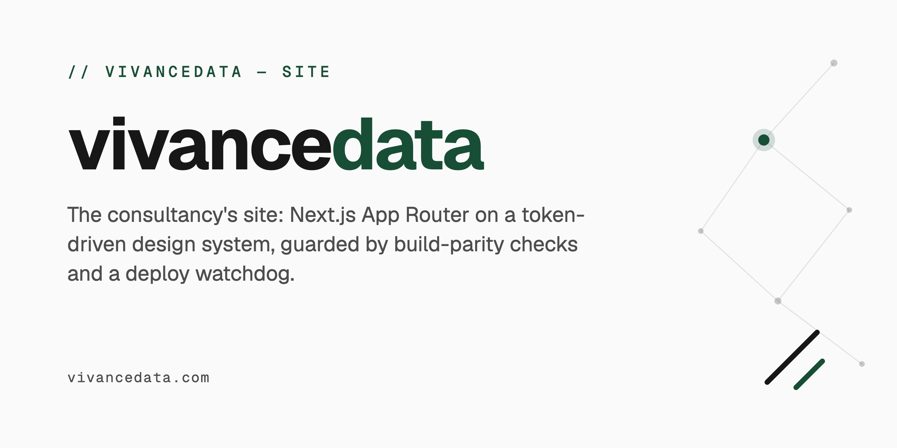

# VivanceData



This is the source for [vivancedata.com](https://www.vivancedata.com), the site for my one-person practice. I'm Lorenzo Scaturchio. I build small, specific software for trade and field businesses: systems that take the after-hours call and the twice-typed paperwork off a small shop. Then I stay on to keep them running.

The site has one job. It explains the work and asks the reader to [book a call](https://www.vivancedata.com/contact).

## What is on the site

- **Industries:** construction, HVAC and trades, logistics, manufacturing. Pages for other industries were removed on purpose, and their old paths redirect to `/industries`.
- **Services:** consulting, generative AI, training.
- **Tools:** a missed-call cost tool, an ROI calculator, an AI readiness assessment and a use-case explorer. Each one computes from what the visitor types and can email a report.
- **Blog:** MDX posts read from the filesystem at build time.
- **Also:** pricing, methodology, partners, resources, a contact form, and the legal pages.

`src/app/` is the full list of routes. This README does not repeat it, because a copied list goes out of date.

## Content rules

These rules decide what may appear on the site. `PRODUCT.md` holds the full record.

- **No claim the practice has not earned.** No testimonials, client logos, named case studies or outcome numbers until a named client has agreed in writing to that exact wording.
- **First person singular.** One person does the work, so the site says "I", not "we".
- **One call to action:** "Book a call".
- **The name is "VivanceData"**, with a capital V and a capital D. The GitHub path (`Vivancedata/…`), the domain and the package names are identifiers and keep their own spelling.
- The demos that the site links to run on sample data.

## Run it locally

You need Node.js 22.x (`engines.node` in `package.json`) and npm. The repo is npm-only: `package-lock.json` is the one lockfile, and CI and Vercel both install with `npm ci`.

```bash
git clone https://github.com/Vivancedata/vivancedata.git
cd vivancedata
cp .env.example .env.local
npm ci
npm run dev
```

The site is then at [http://localhost:3000](http://localhost:3000).

The forms need an email provider. Without one, the email routes answer 503. Set `EMAIL_DRY_RUN=1` in `.env.local` to make them report success without sending anything.

## Environment variables

These are the variables the app code reads. `.env.example` also lists some that are optional tooling.

| Variable | What it does |
|----------|--------------|
| `RESEND_API_KEY` | Sends the contact form and tool-report emails. Without it, and without `EMAIL_DRY_RUN`, those routes answer 503. |
| `EMAIL_DRY_RUN` | Local only. `1` reports success without sending anything. |
| `CONTACT_FORM_TO_EMAIL`, `CONTACT_FORM_FROM_EMAIL` | Optional. Default to `lorenzo@vivancedata.com` and `noreply@vivancedata.com`. |
| `CONVERTKIT_API_KEY`, `CONVERTKIT_FORM_ID` | Newsletter sign-up through ConvertKit. |
| `MAILCHIMP_API_KEY`, `MAILCHIMP_AUDIENCE_ID` | Newsletter sign-up through Mailchimp. |
| `UPSTASH_REDIS_REST_URL`, `UPSTASH_REDIS_REST_TOKEN` | Rate limiting for the API routes. Without them, each server instance keeps its own in-memory limit. |
| `NEXT_PUBLIC_GA_MEASUREMENT_ID` | Google Analytics 4. |
| `SENTRY_DSN`, `NEXT_PUBLIC_SENTRY_DSN` | Error tracking. The server uses `SENTRY_DSN` first, then the public one. |
| `SENTRY_ORG`, `SENTRY_PROJECT` | Sentry build settings. |
| `OBSERVABILITY_TEST_TOKEN` | Authorizes `POST /api/observability/sentry-test`. |

Never commit a real value. `.env.local` is for your machine only.

## Commands

| Command | What it does |
|---------|--------------|
| `npm run dev` | Dev server on port 3000 (Turbopack) |
| `npm run build` | Production build (Webpack) |
| `npm start` | Serves the production build |
| `npm run lint` | ESLint, plus three repo checks: UI boundary, build parity, JSX escapes |
| `npm run lint:fix` | ESLint with auto-fix |
| `npm run type-check` | `tsc --noEmit` |
| `npm run test:unit` | Vitest unit tests with coverage |
| `npm run test:integration` | Vitest integration tests with coverage |
| `npm run test:coverage` | Unit and integration tests, no e2e |
| `npm run test:e2e` | Playwright end-to-end tests |
| `npm test` | All three suites, in order |
| `npm run react-doctor:ci` | React Doctor score check |
| `npm run lighthouse:ci` | Lighthouse score check against a server on port 3000 |
| `npm run analyze` | Bundle analysis |
| `npm run clean` | Removes `.next` and `node_modules/.cache` |

## Tests and checks

```
tests/
├── unit/           Vitest + jsdom
├── integration/    Vitest + Node
└── e2e/            Playwright, against a built production server
```

- **Coverage:** the unit and integration suites each enforce 95% on the files named in their Vitest config. When you add a utility to `src/lib/`, add it to the matching `include` list.
- **End-to-end:** Playwright builds the app and starts it on port **4317**, not 3000. Set `PLAYWRIGHT_BASE_URL` to test a server that is already running. The smoke test must reach at least 85% of the critical routes listed in `tests/e2e/smoke.spec.ts`.
- **CI:** every pull request to `main` runs six checks: Lint, TypeScript Check, Tests + Coverage + E2E, Build, React Doctor (ratchet) and Lighthouse (score floors).

Run one test file with:

```bash
npx vitest run tests/unit/utils.test.ts
```

## How it is built

Next.js 16 (App Router), React 19, TypeScript and Tailwind CSS 4. Exact versions are in `package.json`.

- **Content is data.** Page copy lives in `src/constants/` as typed TypeScript objects. Edit the constants file. Do not add a CMS.
- **The blog reads the filesystem.** A post is `src/app/blog/posts/[slug]/page.mdx`. `src/lib/blogPosts.ts` reads its frontmatter at build time. To add a post, add the file.
- **Industry pages share one component.** `src/components/industries/IndustryPage.tsx` renders every industry page from a config object in that industry's `page.tsx`.
- **The design system lives elsewhere.** Tokens and primitives come from [`@vivancedata/ui`](https://github.com/Vivancedata/ui), pinned to a release tag in `package.json`. A visual change is made in the `ui` repo, released, and then pinned here.
- **Email goes through one module.** `src/lib/email.ts` is the only place that sends. A route never reports success for an email that was not sent.
- **Errors go to Sentry** through `@sentry/nextjs`.

The API routes:

| Route | What it does |
|-------|--------------|
| `POST /api/contact` | Contact form: validates, rate limits, sends the email |
| `POST /api/tool-report` | Emails a tool's report to the visitor |
| `POST /api/newsletter` | Newsletter sign-up |
| `GET /api/health/email` | 200 when email can be delivered, 503 when it cannot. Sends nothing. |
| `/api/observability/sentry-test` | Sentry check. `POST` needs `OBSERVABILITY_TEST_TOKEN`. |

`CLAUDE.md` has more detail on each of these.

## Deploys

**A merge to `main` deploys production.** Vercel installs with `npm ci` and builds with `npm run build`.

No other branch deploys. `vercel.json` turns deployments off for everything except `main`, so a pull request gets no preview. Check a change locally before you merge it.

Two scheduled workflows watch the live site:

- **Deploy Watchdog** runs once a day. It fails when the newest commit on `main` has no successful Production deployment.
- **Production smoke** runs once an hour. It runs `scripts/production_smoke_check.sh` against `www.vivancedata.com`.

`docs/production-go-live-checklist.md` lists the release gates.

## Making changes

1. Branch from `main`.
2. Make the change. Keep to the content rules above.
3. Run the checks:
   ```bash
   npm run lint
   npm run type-check
   npm run test:coverage
   ```
4. Commit with a [Conventional Commits](https://www.conventionalcommits.org/) subject, for example `fix(content): correct the pricing note`.
5. Open a pull request against `main`. All six checks must pass before it merges, because the merge is the deploy.

## More documents

- `PRODUCT.md`: who the site is for, what it may claim, and the decisions that are still open.
- `CLAUDE.md`: architecture notes for people and coding agents.
- `docs/adr/`: architecture decision records.
- `docs/production-go-live-checklist.md`: release gates.

## Contact

[Book a call](https://www.vivancedata.com/contact) through the form on the site.

## Licence

This code is proprietary. The repository is public to read, but no licence is granted to copy, distribute or reuse it.
